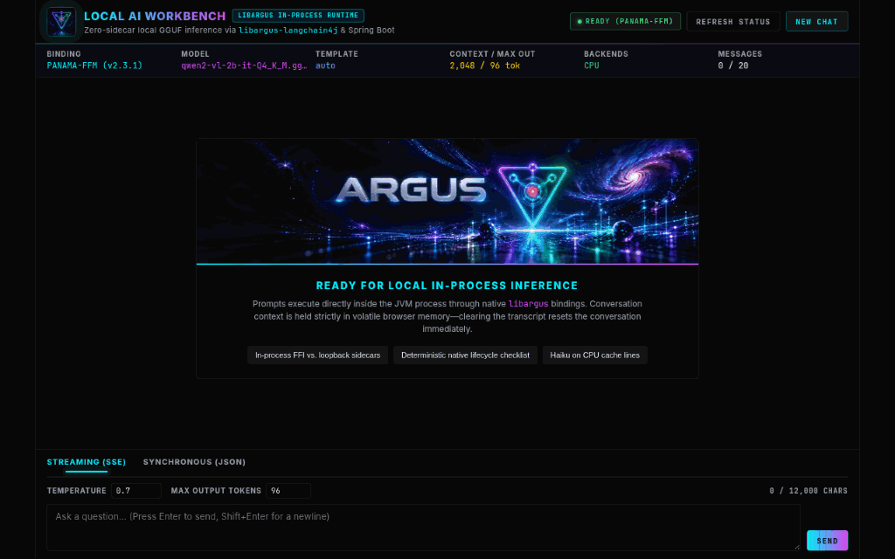
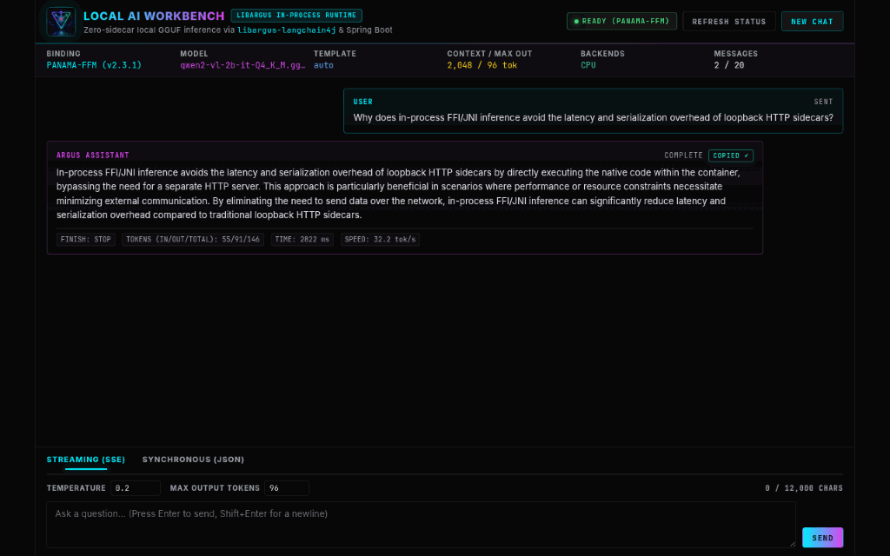
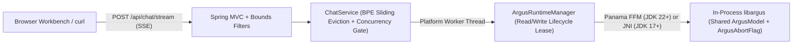

<p align="center">
  
</p>

<h1 align="center">Local AI Workbench — <code>libargus</code> + LangChain4j + Spring Boot</h1>

<p align="center">
  <a href="https://github.com/ProjectArgus-cc/libargus.cc-spring-boot-example/actions/workflows/ci.yml"></a>
  <a href="https://central.sonatype.com/artifact/cc.projectargus/libargus-langchain4j"></a>
  <a href="https://spring.io/projects/spring-boot"></a>
  <a href="https://docs.langchain4j.dev/"></a>
  <a href="https://github.com/ProjectArgus-cc/libargus.cc"></a>
  <a href="LICENSE"></a>
</p>

A tiny, production-grade **Spring Boot 3.4** + **LangChain4j** reference application demonstrating **in-process local GGUF inference**, incremental Server-Sent Events (SSE) token streaming, cooperative C++ cancellation (`ArgusAbortFlag`), and exact BPE token budgeting—with **zero Python sidecars, zero external daemons, and zero cloud API keys**.

> [!TIP]
> **Powered by [`libargus`](https://github.com/ProjectArgus-cc/libargus.cc)** — an open-source, unmanaged C++17 native AI execution runtime engineered for zero-allocation steady-state inference across **LLM text generation**, **bidirectional RAG embeddings**, **Whisper speech-to-text (ASR)**, **text-to-speech (TTS)**, and **Vision/Audio/Video multimodal** pipelines.
>
> Explore and star **[ProjectArgus-cc/libargus.cc](https://github.com/ProjectArgus-cc/libargus.cc)** for full documentation, Android/JNI guides, and low-level Java cookbooks.

<p align="center">
  
</p>

<details>
  <summary><strong>View High-Resolution Workbench Screenshot</strong></summary>
  <br>
  <p align="center">
    
  </p>
</details>

---

## 1. Copy-Paste Into Your Own Spring Boot Project

Want to add in-process local GGUF inference to an existing **Spring Boot + LangChain4j** service? Here is the complete pattern:

### Minimal `pom.xml` Dependencies

```xml
<dependencies>
    <!-- In-process LangChain4j ChatModel, StreamingChatModel, EmbeddingModel & TokenCountEstimator -->
    <dependency>
        <groupId>cc.projectargus</groupId>
        <artifactId>libargus-langchain4j</artifactId>
        <version>2.3.1</version>
    </dependency>

    <!-- Choose libargus-core (JDK 22+ Panama FFM) OR libargus-jni (JDK 17+ / Android — 100% API parity) -->
    <dependency>
        <groupId>cc.projectargus</groupId>
        <artifactId>libargus-jni</artifactId>
        <version>2.3.1</version>
    </dependency>

    <!-- Precompiled native SPI provider (auto-extracts libargus at runtime; swap for cuda/metal/rocm/vulkan) -->
    <dependency>
        <groupId>cc.projectargus</groupId>
        <artifactId>libargus-native-linux-cpu</artifactId>
        <version>2.3.1</version>
        <scope>runtime</scope>
    </dependency>
</dependencies>
```

### Minimal `@Configuration` Wiring Shared Model Weights

```java
@Configuration(proxyBeanMethods = false)
public class LocalAiConfig {

    @Bean(destroyMethod = "close")
    public ArgusModel argusModel(@Value("${argus.chat.model-path}") Path modelPath) {
        ArgusBackend.init();
        return ArgusModel.load(modelPath, /* gpuLayers */ 99, /* useMlock */ false);
    }

    @Bean(destroyMethod = "close")
    public LibArgusChatModel chatModel(ArgusModel sharedModel) {
        return LibArgusChatModel.builder()
            .model(sharedModel) // Shares weights; allocates its own KV cache context
            .chatFormatter(LibArgusChatFormatter.autoDetect())
            .contextLength(4096)
            .maxOutputTokens(512)
            .build();
    }

    @Bean(destroyMethod = "close")
    public LibArgusStreamingChatModel streamingChatModel(ArgusModel sharedModel) {
        return LibArgusStreamingChatModel.builder()
            .model(sharedModel)
            .chatFormatter(LibArgusChatFormatter.autoDetect())
            .contextLength(4096)
            .maxOutputTokens(512)
            .build();
    }
}
```

Because `LibArgusChatModel` and `LibArgusStreamingChatModel` implement standard `dev.langchain4j.model.chat.ChatModel` and `StreamingChatModel`, they plug directly into LangChain4j **`AiServices`**, `@SystemMessage`, `ChatMemory`, Tools, and RAG pipelines—while this repository also exposes constructor-injectable `@Bean` adapters in [`ArgusLangChain4jConfig`](src/main/java/cc/projectargus/workbench/config/ArgusLangChain4jConfig.java) alongside [`ArgusRuntimeManager`](src/main/java/cc/projectargus/workbench/runtime/ArgusRuntimeManager.java) for per-request `ArgusAbortFlag` cancellation and live model recovery.

---

## 2. Architecture & Why In-Process Matters



| Engineering Dimension | Loopback Sidecar (Ollama / Python Daemon) | In-Process [`libargus`](https://github.com/ProjectArgus-cc/libargus.cc) + Spring Boot |
| :--- | :--- | :--- |
| **Process Topology** | Separate OS daemon/container + JVM service | **Single JVM process** (`java -jar app.jar`) |
| **Per-Token Streaming Path** | C++ → Sidecar HTTP/JSON → Loopback TCP → JVM | **Direct FFI memory read** (`Panama FFM` or `JNI`) |
| **Mid-Prefill Cancellation** | Socket disconnect often waits until prefill completes | **Immediate C++ abort** via `ArgusAbortFlag.abort()` |
| **Token Window Budgeting** | Approximate char heuristics or duplicate Java tokenizer | **Exact lock-free native BPE count** (`LibArgusTokenCountEstimator`) |
| **GPU Thread Affinity** | Unmanaged external worker pool | Dedicated platform threads (`argus-inference-worker-*`) avoiding virtual-thread carrier pinning & `cublasHandle_t` hopping |

### Production Patterns Demonstrated in This Repo

1. **First-Class Dual FFI (`JNI` Baseline + Automatic `Panama FFM` Shift):** Starts on portable `libargus-jni` (`--release 17`) for JDK 17–21 and **automatically shifts to Project Panama FFM (`libargus-core`, `--release 22`)** whenever Maven detects JDK 22+—with `Enable-Native-Access: ALL-UNNAMED` stamped into `MANIFEST.MF` so `java -jar` needs zero extra CLI flags.
2. **Deterministic Native Lifecycle & Graceful Shutdown:** [`ArgusRuntimeManager`](src/main/java/cc/projectargus/workbench/runtime/ArgusRuntimeManager.java) initializes native handles in strict forward order, unwinds partial allocations on startup failure, coordinates with `server.shutdown: graceful` + [`ChatService.destroy()`](src/main/java/cc/projectargus/workbench/chat/ChatService.java), and closes all resources in exact reverse order.
3. **Exact BPE Token Budgeting & Sliding Turn Eviction:** Validates multi-turn payloads against `ARGUS_CONTEXT_LENGTH - maxOutputTokens` using native tokenization and automatically evicts oldest `user`/`assistant` turn pairs before KV overflow.
4. **Zero-Build Obsidian Browser Workbench:** Single-page static HTML/CSS/JS UI served at `http://127.0.0.1:8080` with strict CSP headers, XSS-safe `textContent` rendering, live `tok/s` telemetry, one-click reply copy, and dual-path `STOP` cancellation.

---

## 3. Quick Start (60 Seconds)

### Prerequisites
* **Java:** JDK 17 or newer (JDK 17/21 runs via **JNI**; JDK 22/25 LTS automatically shifts to **Project Panama FFM**).
* **Local GGUF Model:** Any instruct/chat `.gguf` model on disk (e.g., `Qwen2.5-1.5B-Instruct-Q4_K_M.gguf`, `Llama-3.2-3B-Instruct-Q4_K_M.gguf`, `gemma-2-2b-it-Q4_K_M.gguf`, or `Mistral-7B-Instruct-v0.3-Q4_K_M.gguf`). This app **never auto-downloads weights** at startup.

### Step 1 — Run Tests & Package (No Model File Needed)

```bash
./mvnw clean test package
```

### Step 2 — Launch the Workbench With Your `.gguf` Model

```bash
ARGUS_CHAT_MODEL_PATH="/absolute/path/to/Qwen2.5-1.5B-Instruct-Q4_K_M.gguf" \
  java -jar target/libargus-spring-boot-example-2.3.1.jar
```

*(Or run directly via Maven: `ARGUS_CHAT_MODEL_PATH="/absolute/path/to/model.gguf" ./mvnw spring-boot:run`.)*

Open **`http://127.0.0.1:8080`** in your browser—check the top-right status badge (`READY (PANAMA-FFM)` on JDK 22+ or `READY (JNI)` on JDK 17–21) and start chatting!

---

## 4. FFI Binding & Hardware Accelerator Profiles

### Automatic FFI Selection (`Panama FFM` vs. `JNI`)

| Environment / Flag | Active Binding Artifact | Bytecode Target | Notes |
| :--- | :--- | :--- | :--- |
| **JDK 17 – 21 (Default)** | `cc.projectargus:libargus-jni:2.3.1` | `--release 17` | Zero JVM flags; broad enterprise & Android parity |
| **JDK 22+ (Auto-Activated)** | `cc.projectargus:libargus-core:2.3.1` | `--release 22` | Project Panama FFM (`MemorySegment` / `Linker`); `MANIFEST.MF` sets `Enable-Native-Access: ALL-UNNAMED` |
| **JDK 22+ with `-Pjni`** | `cc.projectargus:libargus-jni:2.3.1` | `--release 17` | Explicit override to cross-compile a portable JDK 17 JAR from a JDK 22/25 machine |

### OS & GPU Accelerator Profiles

By default, [`pom.xml`](pom.xml) bundles `libargus-native-linux-cpu`. Activate any platform/GPU classifier profile (which composes cleanly with `panama` or `-Pjni`):

| Target Platform / Accelerator | Maven Profile | Native SPI Artifact (`2.3.1`) |
| :--- | :--- | :--- |
| **Linux x86_64 CPU (Default)** | `-Plinux-cpu` | `cc.projectargus:libargus-native-linux-cpu:2.3.1` |
| **Linux x86_64 NVIDIA CUDA** | `-Plinux-cuda` | `cc.projectargus:libargus-native-linux-cuda:2.3.1` |
| **Linux x86_64 AMD ROCm** | `-Plinux-rocm` | `cc.projectargus:libargus-native-linux-rocm:2.3.1` |
| **Linux x86_64 Vulkan** | `-Plinux-vulkan` | `cc.projectargus:libargus-native-linux-vulkan:2.3.1` |
| **macOS Apple Silicon Metal** | `-Pmacos-metal` | `cc.projectargus:libargus-native-macos-metal:2.3.1` |
| **Windows x86_64 CPU** | `-Pwindows-cpu` | `cc.projectargus:libargus-native-windows-cpu:2.3.1` |
| **Windows x86_64 NVIDIA CUDA** | `-Pwindows-cuda` | `cc.projectargus:libargus-native-windows-cuda:2.3.1` |
| **Windows x86_64 Vulkan** | `-Pwindows-vulkan` | `cc.projectargus:libargus-native-windows-vulkan:2.3.1` |

```bash
# macOS Apple Silicon (Metal GPU offload)
ARGUS_CHAT_MODEL_PATH="/path/to/model.gguf" ARGUS_GPU_LAYERS=99 \
  ./mvnw spring-boot:run -Pmacos-metal

# Linux NVIDIA CUDA GPU offload
ARGUS_CHAT_MODEL_PATH="/path/to/model.gguf" ARGUS_GPU_LAYERS=99 \
  ./mvnw spring-boot:run -Plinux-cuda
```

---

## 5. Configuration Reference

All settings in [`src/main/resources/application.yml`](src/main/resources/application.yml) bind to validated [`ArgusWorkbenchProperties`](src/main/java/cc/projectargus/workbench/config/ArgusWorkbenchProperties.java) (`argus.chat.*`):

| Environment Variable | Property | Default | Description |
| :--- | :--- | :--- | :--- |
| `ARGUS_CHAT_MODEL_PATH` | `argus.chat.model-path` | *(unset)* | **Required.** Path to a local `.gguf` chat/instruct model file. |
| `ARGUS_CHAT_FORMATTER` | `argus.chat.chat-formatter` | `auto` | Prompt template (`auto`, `chatml`, `llama3`, `gemma`, `mistral`, `fallback`). |
| `ARGUS_CHAT_MODE` | `argus.chat.chat-mode` | `both` | Active adapter mode: `both` (sync + SSE streaming), `stream`, or `sync`. |
| `ARGUS_CONTEXT_LENGTH` | `argus.chat.context-length` | `4096` | KV cache context window in tokens (`128`–`131072`). |
| `ARGUS_MAX_OUTPUT_TOKENS` | `argus.chat.max-output-tokens` | `512` | Maximum generated tokens per response (`1`–`32768`, `< contextLength`). |
| `ARGUS_GPU_LAYERS` | `argus.chat.gpu-layers` | `0` | Model layers offloaded to GPU (`0` = CPU-only). |
| `ARGUS_CPU_THREADS` | `argus.chat.cpu-threads` | `0` | CPU threads for evaluation (`0` = auto-detect physical cores). |
| `ARGUS_TEMPERATURE` | `argus.chat.temperature` | `0.7` | Default sampling temperature (`0.0` = greedy argmax, up to `2.0`). |
| `ARGUS_MAX_CONCURRENT_INFERENCE` | `argus.chat.max-concurrent-inference` | `1` | Max simultaneous inference jobs before returning HTTP `429`. |
| `ARGUS_MAX_PROMPT_CHARS` | `argus.chat.max-prompt-chars` | `12000` | Max characters per message and per conversation payload. |
| `ARGUS_MAX_HISTORY_MESSAGES` | `argus.chat.max-history-messages` | `20` | Max conversation messages accepted per request. |
| `ARGUS_MAX_REQUEST_BODY_BYTES` | `argus.chat.max-request-body-bytes` | `65536` | Max raw JSON request body bytes before returning HTTP `413`. |
| `ARGUS_INFERENCE_TIMEOUT_SECONDS` | `argus.chat.inference-timeout-seconds` | `180` | Per-request generation timeout in seconds. |
| `ARGUS_FAIL_FAST_STARTUP` | `argus.chat.fail-fast-startup` | `true` | Fail immediately if model is missing (`false` boots UI in degraded state and live-recovers once the file arrives). |
| `ARGUS_SYSTEM_PROMPT` | `argus.chat.system-prompt` | *(concise assistant)* | Trusted server-owned system instruction prepended to every request. |
| `SERVER_ADDRESS` | `server.address` | `127.0.0.1` | Bind address (loopback-only by default). |
| `SERVER_PORT` | `server.port` | `8080` | HTTP listen port. |

> [!NOTE]
> **VRAM / RAM Tip on `ARGUS_CHAT_MODE`:** `LibArgusChatModel` and `LibArgusStreamingChatModel` share a single `ArgusModel` weight allocation in memory, while each adapter maintains its own `ArgusContext` KV cache. On memory-constrained machines or with large context windows, set `ARGUS_CHAT_MODE=stream` (or `sync`) to allocate only one KV cache context.

---

## 6. HTTP & SSE API (`curl` Examples)

### `GET /api/status` — Runtime Readiness & Active FFI Telemetry

```bash
curl -s http://127.0.0.1:8080/api/status
```

```json
{
  "status": "ready",
  "chatEnabled": true,
  "binding": "panama-ffm",
  "runtimeVersion": "2.3.1",
  "availableBackends": ["CPU"],
  "modelName": "Qwen2.5-1.5B-Instruct-Q4_K_M.gguf",
  "chatFormatter": "auto",
  "contextLength": 4096,
  "maxOutputTokens": 512,
  "gpuLayers": 0,
  "maxConcurrentInference": 1,
  "activeInferenceCount": 0,
  "maxPromptChars": 12000,
  "maxHistoryMessages": 20
}
```

### `POST /api/chat/stream` — Incremental SSE Token Streaming

```bash
curl -N -X POST http://127.0.0.1:8080/api/chat/stream \
  -H "Content-Type: application/json" \
  -H "Accept: text/event-stream" \
  -d '{
    "requestId": "demo-stream-1",
    "prompt": "Write a haiku about CPU cache lines.",
    "temperature": 0.0,
    "maxOutputTokens": 64
  }'
```

```text
event:start
data:{"requestId":"demo-stream-1","promptTokens":28,"evictedMessages":0}

event:token
data:{"text":"Sixty-four "}

event:token
data:{"text":"bytes aligned,\n"}

event:complete
data:{"requestId":"demo-stream-1","text":"Sixty-four bytes aligned,\n...","finishReason":"STOP","cancelled":false,"usage":{"inputTokens":28,"outputTokens":17,"totalTokens":45},"evictedMessages":0,"durationMs":318}
```

### `POST /api/chat` — Synchronous JSON Chat

```bash
curl -s -X POST http://127.0.0.1:8080/api/chat \
  -H "Content-Type: application/json" \
  -d '{
    "requestId": "demo-sync-1",
    "messages": [
      { "role": "user", "content": "Give one reason to run GGUF models in-process on the JVM." }
    ],
    "temperature": 0.2,
    "maxOutputTokens": 128
  }'
```

### `POST /api/chat/stop` — Cooperative Native Cancellation

```bash
curl -s -X POST http://127.0.0.1:8080/api/chat/stop \
  -H "Content-Type: application/json" \
  -d '{"requestId": "demo-stream-1"}'
```

---

## 7. Opt-In Real GGUF Integration Suite

All default unit, Spring MVC, `@Bean` lifecycle, and Node VM frontend tests execute in ~7 seconds without model weights (`./mvnw test`). To also run [`NativeModelIntegrationTest`](src/test/java/cc/projectargus/workbench/runtime/NativeModelIntegrationTest.java) end-to-end against a real `.gguf` model:

```bash
ARGUS_CHAT_MODEL_PATH="/absolute/path/to/model.gguf" \
  ./mvnw test -Dtest=NativeModelIntegrationTest
```

---

## 8. Security, Operational Boundaries & Troubleshooting

* **Loopback-Only by Default:** Binds strictly to `127.0.0.1:8080` with `Content-Security-Policy`, `X-Frame-Options: DENY`, and `X-Content-Type-Options: nosniff` enforced by [`WebSecurityHeadersFilter`](src/main/java/cc/projectargus/workbench/config/WebSecurityHeadersFilter.java).
* **Trusted System Prompt Ownership:** Client payloads may only submit `"user"` and `"assistant"` messages; `"system"` and `"tool"` roles are rejected with `400 Bad Request`.
* **Bounded Payload & Concurrency Admission:** Raw JSON request bodies are capped before deserialization by [`JsonRequestBodySizeFilter`](src/main/java/cc/projectargus/workbench/config/JsonRequestBodySizeFilter.java) (`413 Payload Too Large`), and excess concurrent requests fail fast with `429 Too Many Requests` (`Retry-After: 2`) rather than queueing unbounded memory.
* **Sanitized Diagnostics:** Startup errors (`[model_not_configured]`, `[model_file_not_found]`, `[invalid_gguf_header]`, `[native_runtime_unavailable]`) render actionable Spring Boot `FailureAnalyzer` guidance on the console while never leaking host filesystem paths or stack traces over HTTP.

---

## Upstream Ecosystem & License

Released under the [MIT License](LICENSE). Built to showcase **[`libargus`](https://github.com/ProjectArgus-cc/libargus.cc)**—the open-source Layer-0 native AI inference engine from [ProjectArgus.cc](https://github.com/ProjectArgus-cc).
